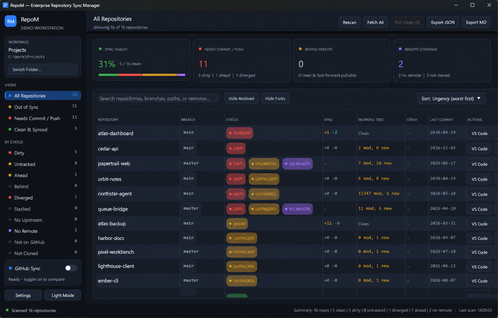

<h1 align="center">RepoM</h1>

<p align="center">
  <b>Scan, monitor, and manage all your local Git repositories against GitHub in one pure-Rust desktop app.</b><br>
  Answer one question fast across every machine you work on: <i>"Is everything I have safely on GitHub?"</i>
</p>

<p align="center">
  
  
  <a href="LICENSE"></a>
  <a href="https://github.com/MenukaDeshan/RepoM/actions/workflows/ci.yml"></a>
  <a href="https://github.com/MenukaDeshan/RepoM/releases/latest"></a>
</p>

<p align="center">
  <a href="#features">Features</a> ·
  <a href="#how-it-works">How it works</a> ·
  <a href="#sync-statuses">Sync statuses</a> ·
  <a href="#configuration">Configuration</a> ·
  <a href="#get-started">Get started</a> ·
  <a href="#downloads">Downloads</a> ·
  <a href="#contributing">Contributing</a>
</p>

<br>

<p align="center">
  
</p>

<table>
  <tr>
    <td width="25%" valign="top">
      <h3>Fast Parallel Scan</h3>
      Inspects 50+ local Git repositories across CPU cores using <code>git2</code> + <code>rayon</code>, plus bounded parallel <code>git fetch</code> via <code>tokio</code> without flashing terminal windows.
    </td>
    <td width="25%" valign="top">
      <h3>GitHub Sync View</h3>
      Compares your local workspace against your GitHub account and organizations to surface repos missing locally (<code>NOT_CLONED</code>) or missing remotely (<code>NOT_ON_GITHUB</code>).
    </td>
    <td width="25%" valign="top">
      <h3>Safe Actions</h3>
      Read-only by default. Fast-forward pull (<code>git pull --ff-only</code>) strictly on clean behind repos, clone missing repos over HTTPS or SSH, or jump straight into VS Code, Explorer, Terminal, or GitHub.
    </td>
    <td width="25%" valign="top">
      <h3>Zero-Secret Config</h3>
      GitHub tokens are read from an environment variable (default <code>GITHUB_TOKEN</code>) or an in-memory session field and are rejected if ever placed in <code>config.toml</code>.
    </td>
  </tr>
</table>

<br>

## Features

- **Pure-Rust native desktop UI (`eframe` / `egui`)** — single standalone executable with no Electron, WebView, browser, or Node.js runtime.
- **Clickable KPI cards & Sync Health bar** — filter instantly by Out of Sync, Needs Commit / Push, Behind Remote, Clean, or any exact status.
- **Instant search & sorting** — filter by repository name, branch, path, or remote URL; hide archived repos or forks; sort by urgency, name, last commit, or change count.
- **Repository Inspector** — view branch, ahead/behind counts, modified/untracked files, local stashes, sanitized remote URLs, submodules, and quick actions in a slide-out panel.
- **JSON & Markdown report export** — export the current view to structured JSON or GitHub-flavored Markdown via a native Save dialog.
- **Dark & Light themes** — switch themes on the fly from the sidebar.
- **Multi-machine privacy rules** — define per-machine `skip_folders` (for example private or client folders) so they are never scanned or exported on that machine.

## How it works

1. **Choose a workspace:** Open RepoM and point it at your projects root folder (for example `C:/Work` or `~/Work`).
2. **Scan local repositories:** Click **Scan** when you are ready. RepoM searches the selected folder and its subfolders, including repositories inside other working trees. Under **Settings → Workspace & Scanning**, **Scan all subfolders** is enabled by default. Turn it off to set a maximum scan depth.
3. **Compare with GitHub (optional):** Toggle **GitHub Sync** in the sidebar to match local remotes against your GitHub user and organization repositories.
4. **Act safely:** Review out-of-sync repositories, run **Fetch All**, fast-forward pull clean behind repos after confirmation, clone missing repos, or export a report.

## Sync statuses

A repository can hold multiple statuses at once (for example `DIRTY` + `AHEAD`) and is sorted worst-first by default:

| Status | Meaning |
|---|---|
| `DIVERGED` | Local branch is both ahead of and behind its upstream branch |
| `DIRTY` | Working tree has modified or staged uncommitted changes |
| `AHEAD` | Local commits have not been pushed to upstream |
| `UNTRACKED` | Working tree contains untracked files |
| `STASHED` | Repository has local stashes that only exist on this machine |
| `NO_REMOTE` | Local repository has no configured Git remote |
| `NO_UPSTREAM` | Current branch has no upstream tracking branch |
| `NOT_ON_GITHUB` | Remote points elsewhere or does not match any repo in your GitHub account/orgs |
| `BEHIND` | Upstream has newer commits you have not pulled yet |
| `NOT_CLONED` | Repository exists on GitHub but is not cloned locally |
| `CLEAN` | Working tree is clean and fully in sync |

## Configuration

You can edit all settings directly inside the app's **Settings** page, or place a TOML configuration file at:

- **Windows:** `%APPDATA%\repom\config.toml`
- **macOS / Linux:** `~/.config/repom/config.toml`
- **Local override:** `./repom.toml` in the current working directory

See [repom.example.toml](repom.example.toml) for a complete template:

```toml
root = "C:/Work"
github_user = "your-username"
github_orgs = []           # e.g. ["my-org"]
token_env = "GITHUB_TOKEN" # Name of env var — never store a raw token here

[scan]
max_depth = 0
exclude = ["node_modules", "99_Archive", ".next", "target", ".venv", "dist", "build"]

[machine]
name = "pc"
skip_folders = []          # Folders skipped from scanning and reports on this machine
```

> [!IMPORTANT]
> **Token security:** RepoM refuses to load config files containing hardcoded `token`, `github_token`, `pat`, `access_token`, or `secret` keys, and strips embedded credentials from HTTP(S) remote URLs before displaying or exporting reports.

## Get started

Requires a recent stable Rust toolchain ([rustup.rs](https://rustup.rs/)).

On Debian or Ubuntu, install the GUI and TLS build libraries first:

```sh
sudo apt-get update
sudo apt-get install -y build-essential pkg-config libssl-dev \
  libxkbcommon-dev libwayland-dev libx11-dev libxrandr-dev \
  libxi-dev libgl1-mesa-dev libgtk-3-dev
```

Then clone, test, and run:

```sh
git clone https://github.com/MenukaDeshan/RepoM.git
cd RepoM
cargo test
cargo build --release
```

Run the standalone release binary:

- **Windows:** `.\target\release\repom.exe` (or double-click `repom.exe` in File Explorer)
- **macOS / Linux:** `./target/release/repom`

## Downloads

Prebuilt installers, portable binaries, and auto-generated release notes are published on the [GitHub Releases](https://github.com/MenukaDeshan/RepoM/releases) page (latest: [releases/latest](https://github.com/MenukaDeshan/RepoM/releases/latest)). Every release includes a `SHA256SUMS.txt` file for verifying downloads.

| Platform | Architecture | Installer / Archive | Notes |
|---|---|---|---|
| Windows | x86_64 | `repom-<ver>-windows-x86_64-setup.exe` | Self-contained setup wizard — no Visual C++ Redistributable or other packages needed |
| Windows | x86_64 (Portable) | `repom-<ver>-windows-x86_64-portable.zip` | Unzip and run `repom.exe` anywhere; zero runtime dependencies |
| macOS | Apple Silicon (arm64) | `repom-<ver>-macos-aarch64.tar.gz` | Unpack and run `repom` |
| macOS | Intel (x86_64) | `repom-<ver>-macos-x86_64.tar.gz` | Unpack and run `repom` |
| Linux | x86_64 | `repom-<ver>-linux-x86_64.tar.gz` | Unpack and run `repom` |

> [!NOTE]
> Windows builds statically link the MSVC C runtime (`+crt-static`) and use Windows built-in TLS (`Schannel`), so RepoM runs on a fresh Windows 10/11 PC without installing Visual C++ Redistributable, WebView2, or .NET. Local repository scanning and GitHub sync work out of the box; optional `Fetch` / `Pull` / `Clone` actions use your system `git` installation.

### Building the Windows setup installer locally

To generate `repom-<ver>-windows-x86_64-setup.exe` and the portable zip locally (requires Rust MSVC toolchain and [Inno Setup 6](https://jrsoftware.org/isinfo.php), e.g. `winget install JRSoftware.InnoSetup`):

```powershell
powershell -ExecutionPolicy Bypass -File packaging/windows/package.ps1
```

Outputs are written to `dist\release\`.

Verify checksums after downloading:

```powershell
# Windows (PowerShell)
Get-FileHash .\repom-<ver>-windows-x86_64-setup.exe -Algorithm SHA256
```

```sh
# macOS / Linux
sha256sum -c SHA256SUMS.txt --ignore-missing
```

## Contributing

Contributions, bug reports, and feature ideas are welcome!

- Read [CONTRIBUTING.md](CONTRIBUTING.md) for branch naming, PR conventions, and local checks.
- Follow our [Code of Conduct](CODE_OF_CONDUCT.md).
- Report security issues privately via [SECURITY.md](SECURITY.md) rather than opening a public issue.
- See [CHANGELOG.md](CHANGELOG.md) and [GitHub Releases](https://github.com/MenukaDeshan/RepoM/releases) for version history.

## License

RepoM is licensed under the [MIT License](LICENSE).
Copyright (c) 2026 Menuka Deshan and RepoM contributors ([CONTRIBUTORS.md](CONTRIBUTORS.md)).
